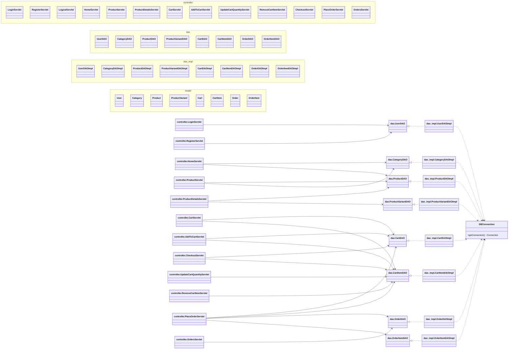

## High-level architecture (Servlet MVC)

```mermaid
flowchart TB
  Browser[Browser] -->|HTTP GET/POST| Servlet[Controller: *Servlet (Jakarta)]
  Servlet -->|calls| DAO[DAO: com.fashionstore.dao.*]
  DAO -->|JDBC| DB[(MySQL: fashion_store)]
  DB --> DAO
  DAO --> Servlet
  Servlet -->|request.setAttribute + forward| JSP[View: WEB-INF/views/*.jsp]
  JSP -->|HTML| Browser

  subgraph Code structure
    Servlet
    DAO
    Model[Model: com.fashionstore.model.*]
    Util[Util: DBConnection]
  end

  DAO -->|maps rows ↔ objects| Model
  DAO -->|gets Connection| Util
```


## Main modules (by package)




## Request routing

- **Annotation routing**: Most controllers are mapped via `@WebServlet("...")` in `com.fashionstore.controller`.
- `**web.xml` routing**: `LoginServlet` and `RegisterServlet` are also declared/mapped in `src/main/webapp/WEB-INF/lib/web.xml`.

