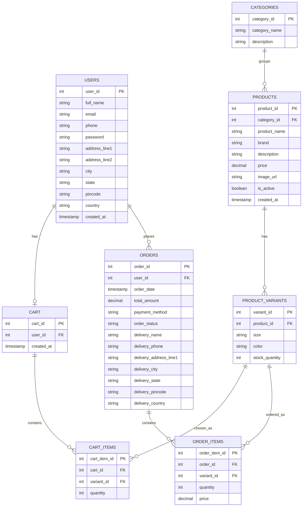
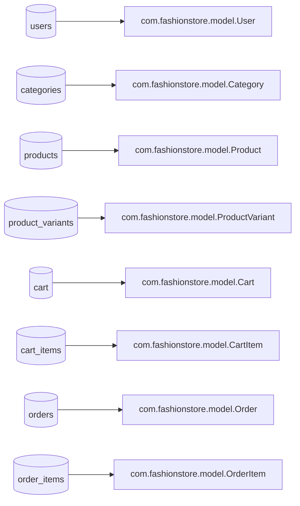

## Database overview

- **Database name**: `fashion_store` (from `com.fashionstore.util.DBConnection`)
- **Access pattern**: direct JDBC via `DBConnection.getConnection()` in each `*DAOImpl`

## ER diagram (inferred from DAO SQL)

## Table ↔ Java mapping

## Table ↔ DAO mapping (where SQL lives)

```mermaid
flowchart TB
  users[(users)] --> UserDAOImpl[com.fashionstore.dao.impl.UserDAOImpl]
  categories[(categories)] --> CategoryDAOImpl[com.fashionstore.dao.impl.CategoryDAOImpl]
  products[(products)] --> ProductDAOImpl[com.fashionstore.dao.impl.ProductDAOImpl]
  product_variants[(product_variants)] --> ProductVariantDAOImpl[com.fashionstore.dao.impl.ProductVariantDAOImpl]
  cart[(cart)] --> CartDAOImpl[com.fashionstore.dao.impl.CartDAOImpl]
  cart_items[(cart_items)] --> CartItemDAOImpl[com.fashionstore.dao.impl.CartItemDAOImpl]
  orders[(orders)] --> OrderDAOImpl[com.fashionstore.dao.impl.OrderDAOImpl]
  order_items[(order_items)] --> OrderItemDAOImpl[com.fashionstore.dao.impl.OrderItemDAOImpl]
```

## Notes / constraints visible in code

- **Cart totals**: computed by `cart_items → product_variants → products` join (see `CartItemDAOImpl.getCartTotal`).
- **Order delivery fields**: `OrderDAOImpl.placeOrder` currently hard-codes city/state/pincode/country to `Chennai / Tamil Nadu / 600001 / India` even though the `Order` model includes those fields.

