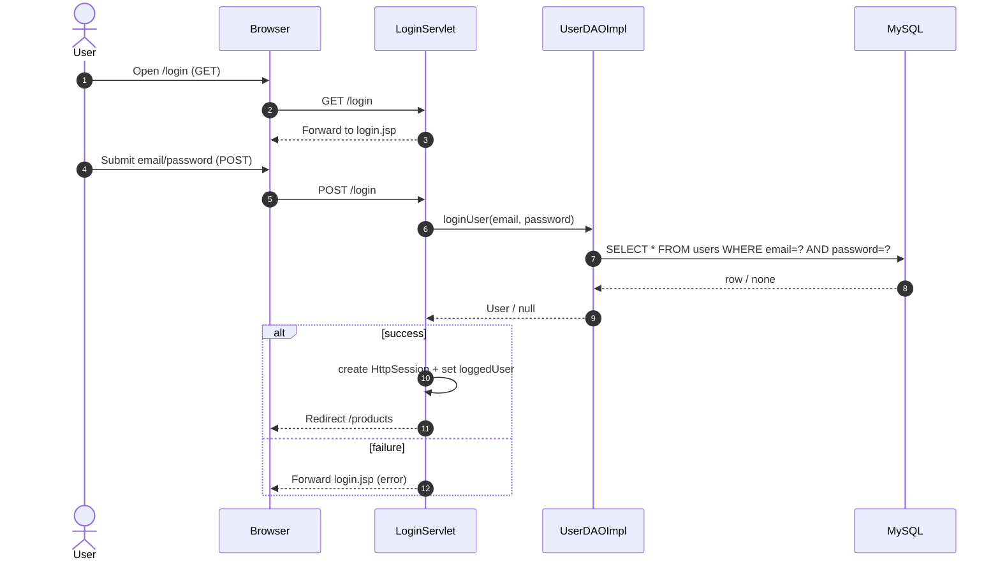
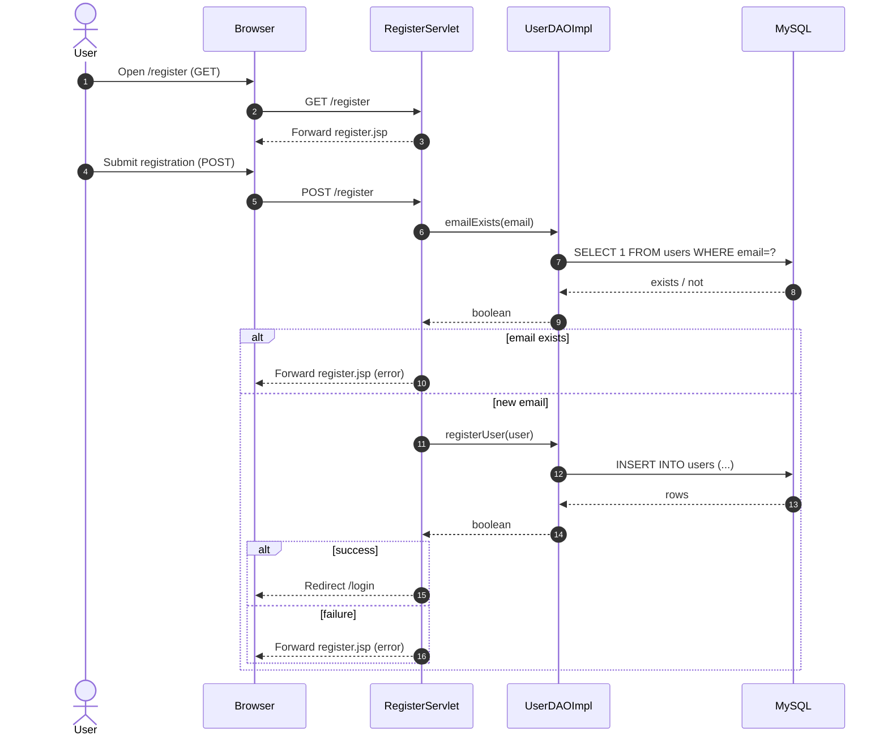
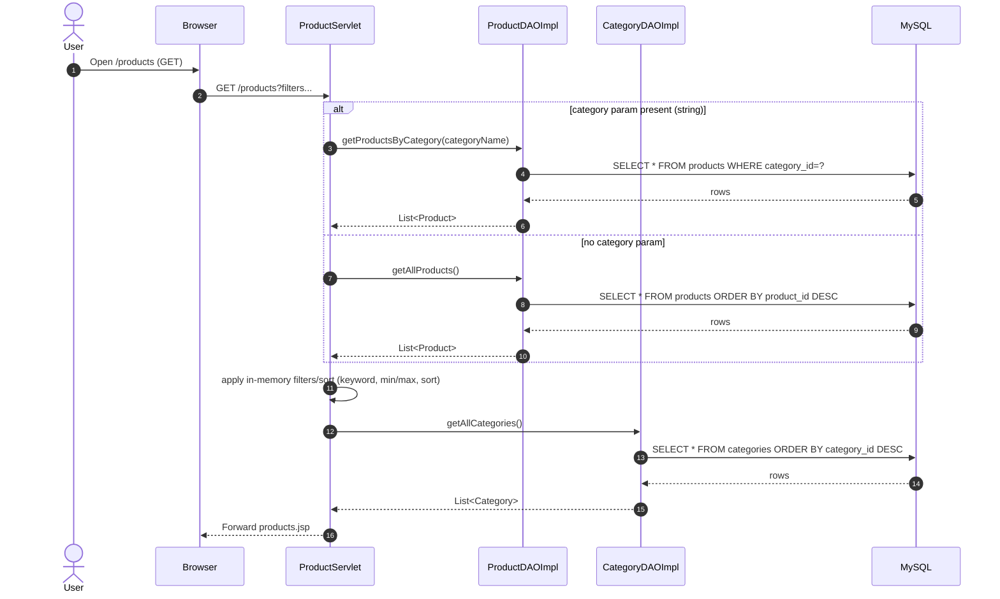
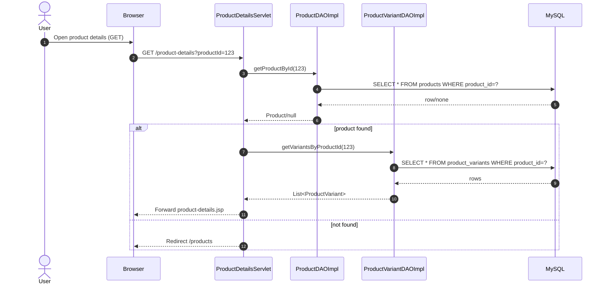
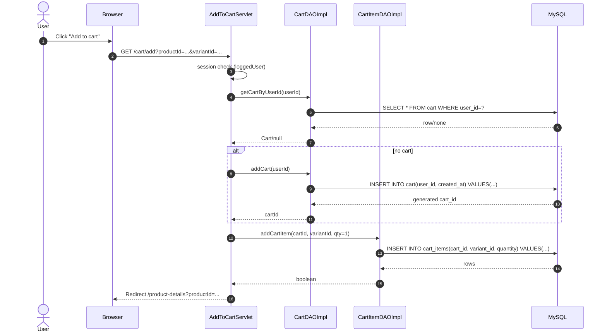
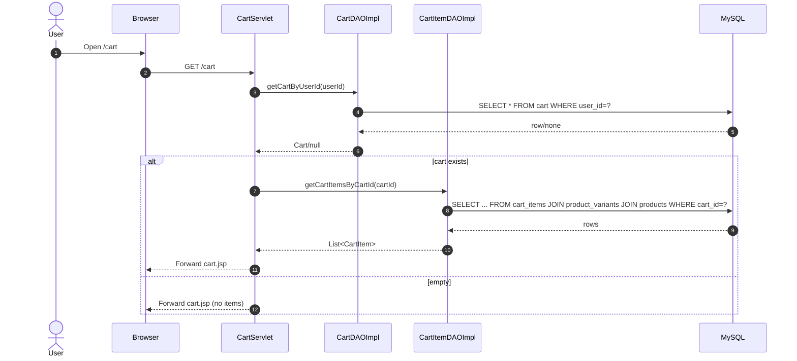
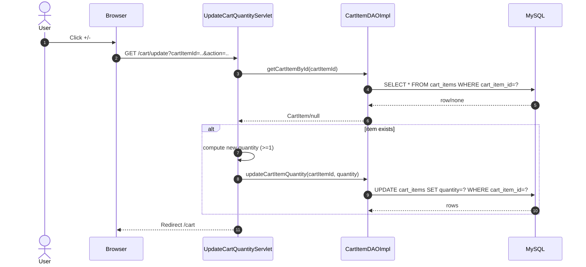
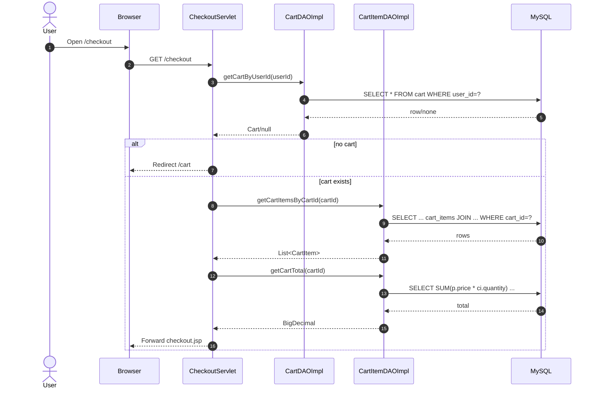
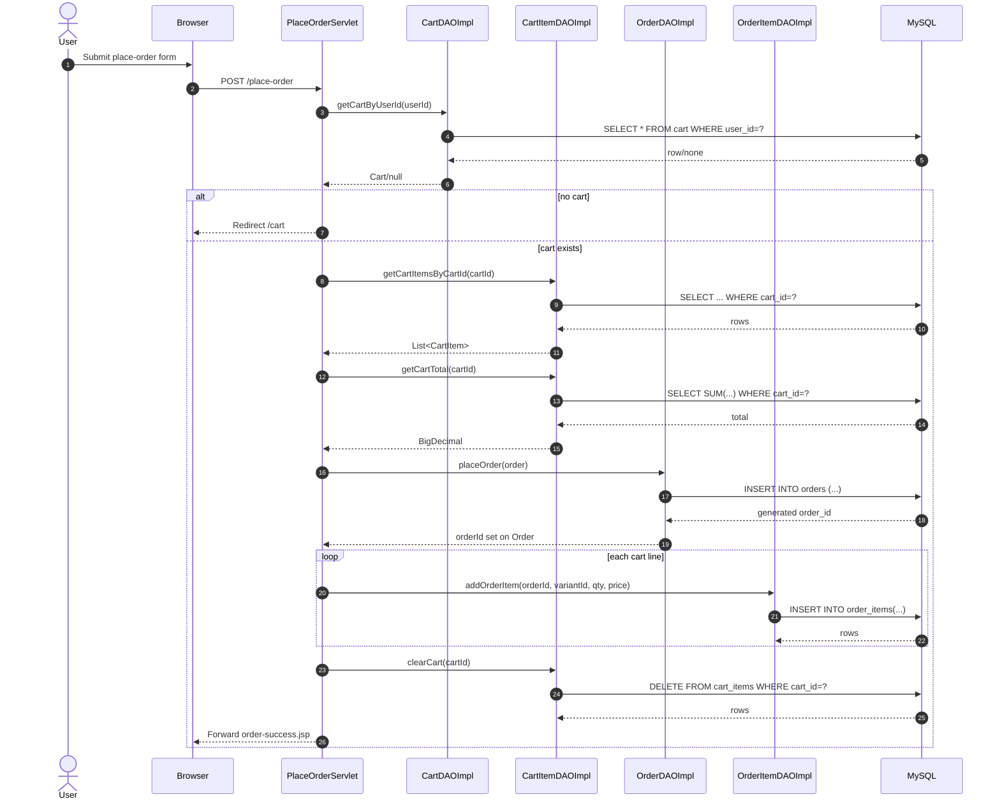
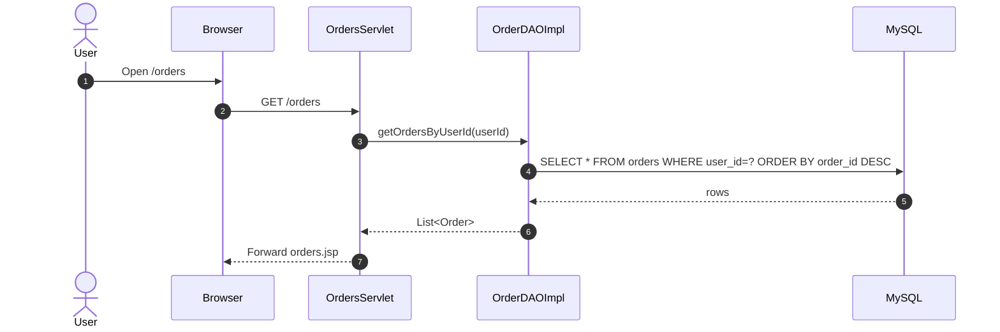

## Application flows (sequence diagrams)

### Login (`/login`)

### Register (`/register`)

### Browse products (`/products`)

### Product details (`/product-details?productId=...`)

### Add to cart (`/cart/add?productId=...&variantId=...`)

### View cart (`/cart`)

### Update cart quantity (`/cart/update?cartItemId=...&action=increase|decrease`)

### Checkout screen (`/checkout`)

### Place order (`/place-order`)

### Orders list (`/orders`)

